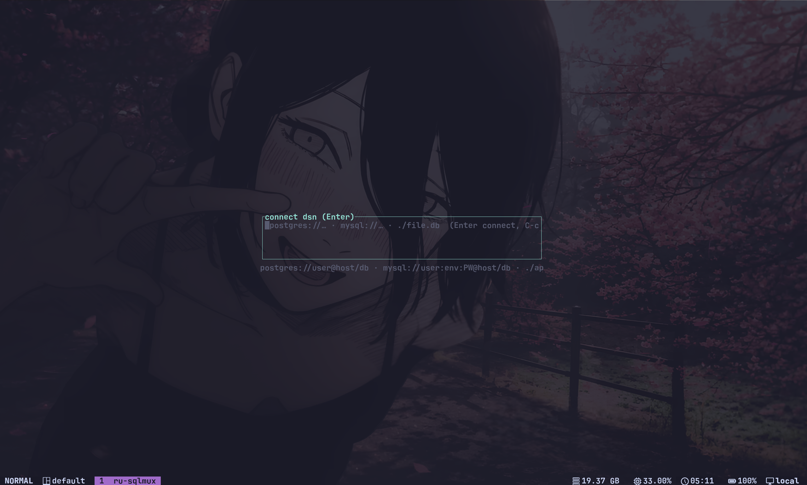
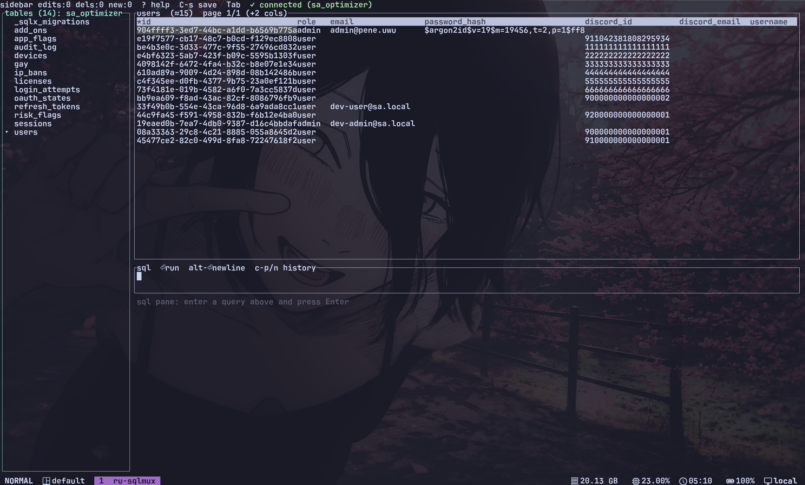

# ru-sqlmux

A terminal database client in Rust for browsing tables, editing cells, and running SQL
against Postgres, MySQL and SQLite. A minimal rebuild of
[sqlmux](https://github.com/kackerx/sqlmux) that keeps the useful core
(transactional in-place editing) and drops the rest

## Previews





```
ru-sqlmux ./app.db
ru-sqlmux "postgres://me@localhost:5432/app"
ru-sqlmux "mysql://me:env:DB_PW@localhost/app"
```
## Keys

| Where | Key | Action |
|---|---|---|
| anywhere | `Tab` | cycle focus: tables → grid → SQL → results |
| anywhere | `C-s` / `C-c` | save pending changes / quit (`?` shows all keys) |
| tables | `j k / Enter` | move, filter (`/`), open table |
| grid | `h j k l` `g G` `[ ]` | move, page; `s` sort column |
| grid | `e o d` | edit cell, insert row, delete row |
| SQL | `Enter` `C-f` `C-p/n` | run, format, history |